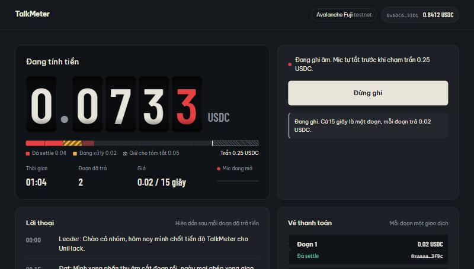

# TalkMeter

**Trợ lý AI cho cuộc họp: họp bao nhiêu phút, trả bấy nhiêu phút.** Bật mic là đồng hồ bắt đầu tính tiền. Mỗi đoạn âm thanh là một lần trả 0.02 USDC qua x402 trên Avalanche. Chạm trần ngân sách thì mic tự tắt. Cuối phiên, TalkMeter tóm tắt cuộc họp, liệt kê việc cần làm kèm người phụ trách và hạn chót, rồi ghi một receipt (biên lai) của cả phiên lên chain.

Team1 Vietnam UniHack 2026, Topic 19.



## Dành cho ai

Sinh viên và nhóm nhỏ họp ít và không đều. Họ không muốn trả 17–18 USD mỗi tháng cho Otter hay Fireflies, cần nghe được tiếng Việt, và không có thẻ quốc tế. Hai cuộc họp 30 phút mỗi tháng tốn 1.30 USDC.

## Cái gì chạy thật, cái gì chưa

| Tính năng | Trạng thái |
|---|---|
| Banner đồng ý ghi âm, ô chưa tích sẵn; không đồng ý thì mic không bật | Chạy |
| Trần ngân sách mỗi phiên; mic tự tắt trước khi chạm trần, giữ sẵn phần cho bản tóm tắt | Chạy |
| Thu mic, cắt đoạn 60 giây (hoặc 15 giây khi quay demo), mỗi đoạn là một file nghe lại được | Chạy |
| Mỗi đoạn một lần thanh toán x402, có link Snowtrace riêng | Chạy (cần ví phiên có USDC test) |
| Transcript tiếng Việt qua Whisper large-v3 (Groq); để trống `STT_LANGUAGE` thì tự nhận cả tiếng Anh | Chạy (cần `GROQ_API_KEY`) |
| Sóng âm trực tiếp, mỗi vạch đỏ đánh dấu chỗ một đoạn bắt đầu được tính tiền | Chạy |
| Sửa lời thoại khi AI nghe nhầm tên riêng; bản tóm tắt dùng bản đã sửa, receipt giữ bản AI nghe được nên vẫn kiểm chứng được | Chạy |
| STT lỗi thì không trừ tiền, tự thử lại một lần, sau đó có nút thử lại | Chạy |
| Hai kiểu phân tích, mỗi lần trả 0.05 USDC. **Họp nhóm**: tóm tắt, quyết định, việc cần làm kèm người phụ trách, hạn và câu gốc. **Phỏng vấn**: chấm điểm theo tiêu chí, gợi ý câu hỏi đào sâu, cảnh báo câu hỏi có nguy cơ thiên vị | Chạy |
| Chép hoặc tải biên bản `.md` | Chạy |
| Receipt on-chain cho cả phiên trong contract `ReceiptLog` | Chạy (cần ví operator và contract) |
| Nút **Kiểm chứng trên chain**: trình duyệt tự tính lại hash và so với contract | Chạy |
| Tải biên lai `.json` và kiểm chứng độc lập bằng `npm run verify-receipt` | Chạy |
| Phỏng vấn thử với AI, thanh toán theo giây, L1 riêng | Chưa làm |
| Đăng nhập, lưu lịch sử, phân biệt người nói, bot tự vào Meet/Zoom | Không nằm trong phạm vi |

**Giới hạn cần nói thẳng:** server tin danh sách mã giao dịch do trình duyệt gửi lên. Receipt chứng minh bản ghi không bị sửa, nhưng chưa chứng minh server đã tự đối chiếu từng giao dịch. Bản đầy đủ sẽ đọc sự kiện `Transfer` của USDC trước khi ghi receipt.

## Trên chain (Avalanche Fuji)

Một phiên chạy thật ngày 21/11/2026 bằng `npm run test-ai`: 3 đoạn âm thanh, 1 bản tóm tắt, 1 receipt.

- Contract `ReceiptLog`: [`0x898af85f88e2d6bd57e7edeae22259f93a75a78a`](https://testnet.snowtrace.io/address/0x898af85f88e2d6bd57e7edeae22259f93a75a78a)
- Ba giao dịch x402 liên tiếp, mỗi giao dịch 0.02 USDC: [đoạn 1](https://testnet.snowtrace.io/tx/0xeee6c853f18e82e26b85af438cda94ea05b12c9ff4c7411b487f6c6512dc144b), [đoạn 2](https://testnet.snowtrace.io/tx/0xb867b704fed15f8962be12fe452d94e9feb24f3cd3f2f6c14dd291bd1d090054), [đoạn 3](https://testnet.snowtrace.io/tx/0xb432e9bca3632f05d69beacbf8a9857594aacab969b76f6e76272ac299ca1253)
- Bản tóm tắt, 0.05 USDC: [giao dịch](https://testnet.snowtrace.io/tx/0x9d56da264fd2acecd690cbd2d943aefa037b6e43537754183f45656aef9a87ea)
- Receipt của phiên đó: [giao dịch](https://testnet.snowtrace.io/tx/0xa3217c8174b2b1655e4d267977f26ddb4ff9fdcc660fe15de147d8cd6657457f), hash `0x1df9b4e5…7e8b1`. Tính lại từ transcript và mã giao dịch thì khớp với `receiptOf`.
- Gas đo được cho một lần settle x402: `86,144 gas × 0.001 gwei ≈ 0.000000086 AVAX`. Ghi receipt: `48,914 gas`.

## Chạy thử

Cần Node 22.9 trở lên và Chrome. Safari không ghi được `audio/webm`; app sẽ tự chuyển sang `audio/mp4` nếu trình duyệt hỗ trợ.

```bash
npm run setup                  # cài thư viện cho server và web
cp .env.example .env.local     # Windows: copy .env.example .env.local; rồi điền PAY_TO và GROQ_API_KEY
npm run new-wallet             # tạo ví operator, dán khóa vào OPERATOR_PRIVATE_KEY
npm run deploy-receipt         # cần ít AVAX test trong ví operator; dán địa chỉ vào RECEIPT_CONTRACT
npm run build && npm start     # mở http://localhost:4021
```

Chạy thử cả phiên không cần mic: để server chạy, rồi ở cửa sổ khác gõ `npm run test-ai`. Script gửi 3 đoạn âm thanh mẫu trong `test/audio/` (tổng cộng 0.11 USDC test từ ví `BUYER_PRIVATE_KEY`), tóm tắt, ghi receipt rồi tự kiểm chứng với chain. File mẫu là tiếng Anh, nên đặt `STT_LANGUAGE=` khi chạy server để lời thoại ra đúng.

Khi đang sửa giao diện, chạy `npm run server` và `npm run client` ở hai terminal rồi mở http://localhost:5173.

Trong app: bấm vào ví ở góc trên, copy địa chỉ ví phiên và lấy USDC test tại [faucet Circle](https://faucet.circle.com) (chọn Avalanche Fuji). Ví phiên không cần AVAX.

**Ba bước cho giám khảo:** (1) mở app, nạp 0.2 USDC test vào ví phiên; (2) tích ô đồng ý, chọn trần 0.10 và đoạn 15 giây, bấm Bắt đầu ghi và nói khoảng một phút; (3) bấm Dừng ghi, chọn Họp nhóm hoặc Phỏng vấn, bấm nút phân tích và ghi receipt, rồi bấm Kiểm chứng trên chain.

## Cách một đoạn được trả tiền

```
Trình duyệt ──POST /api/transcribe (đoạn âm thanh)──► Server
            ◄── 402 Payment Required: 0.02 USDC, Fuji, PAY_TO ──
Ví phiên ký transferWithAuthorization (EIP-3009). Không gửi giao dịch, không cần AVAX.
            ──gửi lại kèm PAYMENT-SIGNATURE──► Server ──verify──► Facilitator
                                               Server gọi Whisper. Lỗi thì trả lỗi, không ai bị trừ tiền.
                                               Server ──settle──► Facilitator ──► USDC trên Avalanche
            ◄── 200 + transcript + PAYMENT-RESPONSE (mã giao dịch) ──
```

Trần ngân sách được giữ ở ba lớp: giao diện giữ chỗ trước cho từng đoạn và cho bản tóm tắt; thư viện x402 từ chối mọi yêu cầu đòi giá cao hơn giá đã niêm yết (`spendControls`); và ví phiên chỉ chứa đúng số USDC người dùng nạp vào.

## Receipt

```
h0 = keccak256(sessionId)
hi = keccak256(h(i-1) ‖ keccak256(transcript_i) ‖ txHash_i)
```

`hn` được ghi vào `ReceiptLog.receiptOf(keccak256(sessionId))`. Chỉ hash lên chain, nội dung cuộc họp thì không. Ai giữ transcript và danh sách giao dịch đều tính lại được `hn`; sửa một chữ ở bất kỳ đoạn nào cũng làm hash lệch. `npm test` kiểm tra điều này và kiểm tra trình duyệt với server tính ra cùng một hash.

Sửa lời thoại trong app không làm hỏng receipt: hash dùng đúng văn bản AI trả về lúc trả tiền, còn bản đã sửa chỉ dùng cho bản tóm tắt và nằm trong trường `edited` của biên lai `.json`.

Receipt được ghi ngay trong route `/api/summary`, vốn đã có trả tiền, nên không ai gọi được để đốt gas của ví operator miễn phí.

## Cấu trúc

| Đường dẫn | Nội dung |
|---|---|
| `src/server.mjs` | Seller: `/api/config` miễn phí, hai route trả phí `/api/transcribe` và `/api/summary`, ghi receipt, phục vụ `client/dist` |
| `src/receipt.mjs` | Công thức hash receipt và ABI của `ReceiptLog` |
| `src/networks.mjs` | Fuji và C-Chain, địa chỉ USDC, hàm `price()` |
| `src/facilitator.mjs` | Facilitator tự chạy, dùng dự phòng khi facilitator công khai lỗi |
| `contracts/ReceiptLog.sol` | Contract lưu một hash cho mỗi phiên |
| `client/src/hooks/useMeeting.js` | Toàn bộ vòng lặp mic → x402 → transcript → tóm tắt → receipt |
| `client/src/lib/x402Client.js` | Ví phiên trong trình duyệt và `fetch` tự trả tiền |
| `client/src/components/` | Đồng hồ, thanh ngân sách, sóng âm, transcript, vé thanh toán, kết quả |
| `scripts/` | Tạo ví, xem số dư, deploy và kiểm chứng receipt |
| `docs/AUDIT.md` | Các lỗi đã tìm và sửa trong bản này |

## Lệnh

| Lệnh | Việc |
|---|---|
| `npm start` | Chạy server, phục vụ bản web đã build |
| `npm run client` | Web ở chế độ dev (Vite, cổng 5173) |
| `npm test` | Kiểm tra công thức receipt |
| `npm run test-ai` | Chạy trọn một phiên có trả tiền thật trên Fuji (cần server đang chạy và USDC test) |
| `npm run deploy-receipt` | Deploy `ReceiptLog` bằng ví operator |
| `npm run verify-receipt -- <file.json>` | Kiểm chứng biên lai tải từ app với chain |
| `npm run facilitator` | Facilitator dự phòng (đặt `FACILITATOR_URL=http://localhost:4022`) |
| `npm run pay`, `npm run balance` | Thử x402 bằng dòng lệnh, xem số dư |

## Vì sao on-chain, vì sao Avalanche, tiền từ đâu

- **On-chain:** thẻ có phí cố định khoảng 0.3 USD, cao hơn giá một phút (0.02). x402 không cần tài khoản, API key hay trang thanh toán, nên một chương trình cũng tự trả được. Receipt cho phép kiểm chứng "trả đúng số phút đã dùng" mà không cần tin nhà cung cấp. Một cơ sở dữ liệu trả trước cũng làm được việc trừ tiền, nhưng người dùng phải tin công ty và không có biên lai kiểm chứng độc lập.
- **Avalanche:** settle khoảng 1–2 giây, gas thấp hơn giá một phút, USDC gốc của Circle hỗ trợ EIP-3009. Một L1 riêng sẽ cho phép ghi receipt từng phút gần như miễn phí.
- **Tiền:** giá bán 0.02 USD/phút, chi phí STT khoảng 0.003–0.006 USD/phút, cộng 0.05 cho mỗi bản tóm tắt. Không có token, không có yield.

## Pháp lý tại Việt Nam

Bản demo chạy trên Fuji với USDC thử nghiệm, không có giá trị thật. USDC không phải phương tiện thanh toán hợp pháp tại Việt Nam (Nghị định 52/2024) và không thuộc nhóm tài sản mã hóa được thí điểm theo Nghị quyết 05/2025. Bản thương mại sẽ phục vụ thị trường ngoài Việt Nam, hoặc thu bằng đồng Việt Nam qua trung gian được cấp phép và chỉ dùng chain để ghi biên lai.

Ghi âm là xử lý dữ liệu cá nhân (Luật Bảo vệ dữ liệu cá nhân, hiệu lực 1/1/2026). TalkMeter xin đồng ý rõ ràng trước khi bật mic, báo rằng âm thanh được AI xử lý, không lưu file âm thanh trên server và chỉ đưa hash lên chain. Âm thanh vẫn được gửi tới API STT ở nước ngoài; hướng khắc phục là tự host model STT.

Đây không phải tư vấn pháp lý.
